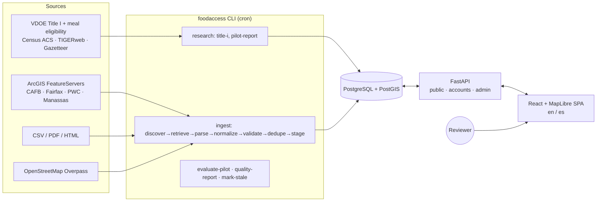

# Architecture

A modular monolith: one FastAPI service, one PostgreSQL/PostGIS database, one React single-page app, and a CLI for
research, ingestion, and maintenance jobs. There are no message brokers or microservices. Jobs run as cron-compatible CLI
commands.

## Backend layout (`backend/app/`)

| Package | Responsibility |
|---|---|
| `config.py`, `db.py`, `vocab.py` | Settings (env `FOODACCESS_*`), DB session, controlled vocabularies shared with the UI |
| `models/` | SQLAlchemy models: `geo` (jurisdictions, school divisions, Title I metrics), `resources` (organizations, locations, services, food types, eligibility, schedules, exceptions, events, offerings, inventory, translations), `provenance` (sources, runs, source records, field provenance, change proposals, duplicates, verification records, audit log), `users` |
| `migrations/` | Alembic. `0001` creates PostGIS, the full schema, spatial GiST indexes, and seeds categories |
| `api/` | `public.py` (search, detail, events, geocode, metadata), `accounts.py` (sessions, favorites, preferences), `admin.py` (review workflow) |
| `auth/security.py` | Argon2id hashing, opaque session tokens stored as SHA-256, CSRF tokens, rate limiting, role checks |
| `geospatial/` | `search.py` (PostGIS radius/viewport/distance + schedule/eligibility evaluation), `geocode.py` (ZIP table → Census geocoder → Nominatim) |
| `ingestion/` | `base.py` (source config, polite fetcher, adapter registry), `adapters/` (generic JSON/CSV/ArcGIS/Overpass/PDF + pilot-specific normalizers), `normalization/`, `deduplication/`, `verification/workflow.py`, `pipeline.py` |
| `services/` | `presenter` (API shapes), `schedule` (recurrence engine), `resource_writer`, `quality`, `registry`, `translation` |
| `research/` | `title_i.py`, `pilot_selection.py`, `evaluation.py`, `reference.py` |
| `cli.py` | `foodaccess` commands |

## Key design decisions

1. **Organizations, locations, and services are separate.** Every service, schedule, and eligibility row belongs to a
   location. Eligibility and schedules can also be scoped to one service. An organization's facts never spread to all
   of its sites automatically.
2. **Eligibility is tri-state** (`required` / `not_required` / `unknown`). A location matches a filter such as "No ID
   required" only when a row confirms `not_required` and no applicable row says `required`. Locations where the
   information is unknown come back in a separate `uncertain` list with the unconfirmed filters named.
3. **Distribution hours are separate from office hours** (`schedules.kind`). Only `distribution` schedules and dated
   events answer "is food available today?". Recurrence supports weekly rules, nth or last weekday of the month,
   seasonal bounds, closures, special hours, and one-time events.
4. **Two-stage search.** PostGIS handles visibility, radius (`ST_DWithin` on `geography`), viewport (`ST_Intersects`
   envelope), category `EXISTS` filters, and geodesic `ST_Distance` ordering. Python then evaluates schedules and
   eligibility for the spatially bounded set (capped at 1,000), because recurrence and tri-state logic are clearer
   there.
5. **Acquisition is separated from publication.** Imports only create or refresh *candidate* locations. When an import
   touches a verified location, each differing value becomes a `ChangeProposal`. A material change (schedule, address,
   services, eligibility, status) sends the listing back to `needs_review`, and it stays public with its verified
   values until a reviewer decides. A record that disappears from a source flags the listing for review; it never
   closes it.
6. **Idempotency.** The key `(source_id, external_id)` plus a hash of the normalized record classifies each record as
   unchanged, updated, or conflict. Cross-source matches use a rule-based score (name, address, distance, phone,
   domain). The score only routes records (auto-link / review / new) and is never shown publicly. When the same
   address has different names, the record goes to review and is never auto-merged.
7. **Publication rules.** Publishing requires a `verify` action by a named admin (with method), coordinates, at least
   one source record, and a source whose terms permit republication. If no source permits it, the most recent
   verification must have been made directly with the provider. Synthetic fixtures cannot be published in production
   and are hidden unless `FOODACCESS_SHOW_SYNTHETIC=true`.
8. **Free infrastructure only.** Map tiles come from OpenFreeMap via MapLibre (configurable style URL). Geocoding uses
   Census, which is free and needs no key, with Nominatim as an optional, rate-limited fallback. Translation is
   optional, through self-hosted LibreTranslate or Argos. No analytics or trackers.

## Data flow for a search

1. The UI geocodes a ZIP code (offline Census ZCTA centroid) or an address (Census geocoder) through `/api/geocode`.
   Device location is used only in the browser and sent as coordinates per request; it is never stored.
2. `/api/resources/search` runs the SQL stage, then evaluates schedules and eligibility. It returns `items`,
   `uncertain`, match reasons, warnings, and a coverage notice (whether the search circle lies inside the active
   pilot/expansion boundaries).
3. The UI renders the map (clustered GeoJSON source) and the list from the same result array, keeping a shared
   selection.
